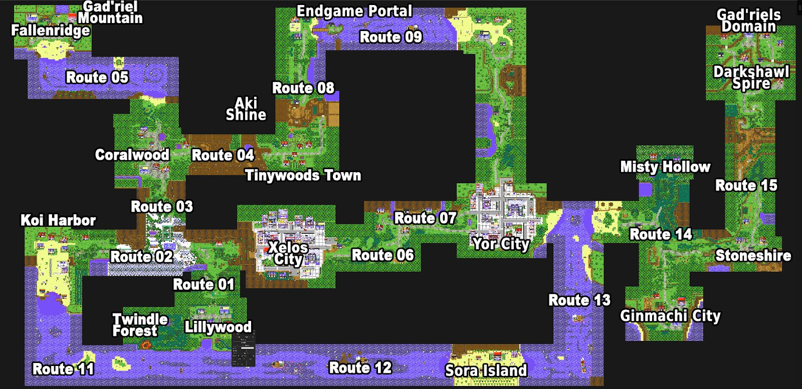
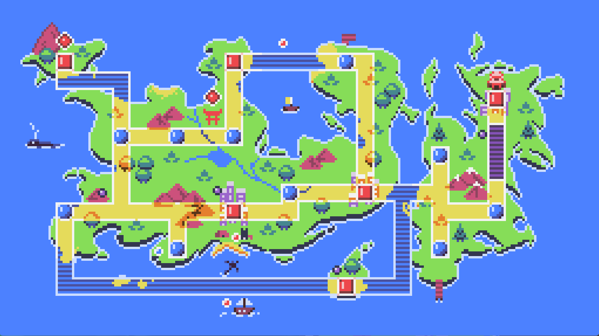

<h1>Explore the World of Dokimon <small>(This contains spoilers!)</small></h1>

  

    <button class="tab-button active" data-tab="story">Story</button>
    <button class="tab-button" data-tab="characters">Characters</button>
    <button class="tab-button" data-tab="maps">Maps</button>
  

  

  
<strong>Dokimon: Quest – Story</strong>

  
You play as a young adventurer in the peaceful town of Lillywood, alongside your childhood friends Ai and Koi. One day, the local professor is looking for you—you overslept! You’re quickly thrown into a journey with your first Dokimon, Whispurr, and are soon joined by Koi, who insists on giving you your first real battle.

  
<strong>The Call to Adventure</strong>

  
  
You and your friends are driven by a deeper goal: to find Maiko, your long-lost childhood friend who vanished mysteriously 12 years ago. As the journey unfolds, strange dreams and visions suggest Maiko is still alive—but trapped somewhere beyond ordinary reach. Ai, who has emotional ties to Maiko, joins your party to help on this dangerous journey.

  
<strong>Confronting the X’ers</strong>

  
  
A sinister organization called the X’ers begins to make moves in the shadows. They're conducting dangerous experiments involving "Bound Dokimon" and forging contracts with monstrous entities for power. You foil their early plans in several towns and uncover that they're attempting to re-create a godlike Dokimon through dark rituals.

  
<strong>Mystics and Monsters</strong>

  
  
Along the way, you meet Aki, a sage with visions and spiritual powers, who confirms that Maiko is alive—but in grave danger, buried deep beneath the earth, surrounded by lava. Aki guides you through your path, eventually helping you infiltrate the X’er’s base using a disguise crafted by a surprisingly crafty sailor who enjoys knitting.

  
As you confront X’er generals and uncover dark secrets, Aki is struck down by an unknown force tied to the realm of darkness. You’re left to continue alone, burdened with more questions than answers.

  
<strong>Enter the Shadow Realm</strong>

  
  
Venturing deeper into mystical and corrupted places, you begin experiencing disturbing visions and confrontations with a powerful entity that challenges your very purpose. You're eventually told that Maiko is imprisoned in the Shadow Realm by a being known as Gad’riel, the destroyer of worlds.

  
<strong>Clash of Mythics</strong>

  
  
In a climactic series of battles, you confront Magma, a powerful Mythic Dokimon and the son of Gad’riel. Unlike his father, Magma still clings to his morality and agrees to help you—if you can defeat him in battle.

  
With Magma’s help, you find Maiko… but she is not the same. Years of exposure to the Shadow Realm have changed her. Gad’riel finally appears, challenging you directly.

  
<strong>Final Confrontation</strong>

  
  
You defeat Gad’riel in a fierce battle. True to his word, he leaves the planet. But the victory comes at a cost—Maiko has been rescued, yet remains altered, her mind warped by darkness. Your quest is far from over.

  
<strong>A New Beginning</strong>

  
  
With the truth revealed and Maiko back in the physical world, your next journey becomes clear: to restore her soul and identity. But that tale will be for another game...

  

  

<!-- Character Bios -->
  <section class="character-bios">

    

      <h3>The Player</h3>
      
You are a determined young adventurer setting out to become a Dokimon Ranger. You're brave, loyal, and driven by a personal mission—to find your lost childhood friend, Maiko. Over time, you uncover dark truths, battle a sinister organization, and push the boundaries between the natural and supernatural.

    

    

      <h3>Ai</h3>
      
Gentle, empathetic, and deeply affected by Maiko’s disappearance. Ai initially stays behind to recover from an incident, but later joins your party to support your journey. Though insecure in battle at first, she becomes a vital ally, capable of healing your team and growing stronger by your side. She later undergoes a spiritual transformation and gains renewed resolve.

    

    

      <h3>Koi</h3>
      
Energetic, protective, and your first rival. Koi has a strong bond with Dokimon and often provides motivation through friendly competition. She plays a key role in lifting spirits and remains an important support as the story progresses. Koi helps uncover secrets behind the X’ers and often leads efforts to move forward when the group feels lost.

    

    

      <h3>Maiko</h3>
      
Mysteriously disappeared 12 years ago. Maiko’s memory drives the main characters forward. As the story progresses, you discover she was taken into the Shadow Realm by Gad’riel and exposed to its corrupting influence. Though physically rescued, her mind and soul remain altered, hinting at a longer journey ahead to restore her fully.

    

    

      <h3>Aki</h3>
      
Wise and calm, Aki helps guide your journey using her spiritual connection to the world and its hidden forces. She helps you interpret visions, infiltrate enemy bases, and uncover Maiko’s location. Eventually, Aki is severely wounded during an encounter in a spiritual realm, putting her out of commission. Her recovery is left uncertain, but her guidance shapes the entire adventure.

    

    

      <h3>Professor Rei</h3>
      
Rei provides rational insight and technical support for your journey, including the D-Tech device. She is one of the few who understands both the science and supernatural elements of the Dokimon world. Rei also receives visions, though less frequently than Aki, and believes in your mission. She coordinates with Ai and Koi while you’re away.

    

    

      <h3>The X’ers</h3>
      
A chaotic group that binds Dokimon to their will, seeking power through contracts with dark forces. Their leader, Xe, is manipulative and power-hungry, attempting to recreate a godlike Dokimon. The X’ers are scattered across the world, interfering in towns and sacred areas, eventually leading to their confrontation with you and your allies.

    

    

      <h3>Gad’riel</h3>
      
A mythic being who once decimated planets and now resides in the Shadow Realm. He abducted Maiko for reasons even he has forgotten, having succumbed to endless destruction and despair. After your confrontation, he leaves the planet, but not without warning that Maiko’s mind may never fully recover.

    

    

      <h3>Magma</h3>
      
Trapped and nearly used in experiments by the X’ers, Magma resists their attempts to force a contract. He offers you a crucial battle—one that determines whether you're ready to face his father. Unlike his father, Magma still possesses compassion and helps point the way to Maiko.

    

    

      <h3>Captain</h3>
      
Tasked with helping you infiltrate the X’er base, the Captain sews a convincing disguise after you mention his hobby. Despite his tough exterior, he's a humorous and helpful ally.

    

    

      <h3>Black Belt Bros</h3>
      
They support your attack on the X’er base, helping create distractions and looking for ways to crack enemy codes. They are both comic relief and tactical backup.

    

  </section>
  

  

    <h2>World Maps</h2>

    
    
  

